# TrikeKoTo — End-User Manual

*Version 1.1.1 (12) · October 2026*

> Generated by `scripts/build_user_manual.cjs`. Edit the script and rebuild; do not edit this file by hand.

## 1. Introduction

TrikeKoTo is a tricycle ride-hailing system for Tricycle Operators and Drivers’ Associations (TODA). A commuter books a tricycle from a phone, the system offers the ride to the nearest available driver, and both follow the trip on a live map until the passenger is dropped off.

This manual explains how to install and use the system. It has one part for each kind of user:

- **Commuters** — passengers who book rides (Section 4).
- **Drivers** — TODA members who accept and complete rides (Section 5).
- **Administrators** — TODA officers who approve drivers and IDs and run the service (Section 6).

### How to read this manual

The app opens in Filipino. Buttons and labels are written the way they appear on screen, with the English wording in brackets — for example **Mag-book ng ride** (Book a ride). If you switch the app to English, look for the wording in brackets.

> **Note:** This manual describes version 1.1.1 (12). The version is printed at the bottom of the landing screen, the driver screen, the commuter Profile screen and the ID verification screen.

## 2. Before You Start

### 2.1 What you need

|  | Requirement |
|---|---|
| Android phone | Android 7.0 or newer, with GPS and an internet connection (mobile data or Wi-Fi). |
| iPhone, tablet or computer | A current web browser. Use the web version at **trikekoto.web.app**. |
| Commuters | A Philippine mobile number that can receive SMS, and a government-issued ID. |
| Drivers | An email address, a registered tricycle and plate number, TODA membership, and a government-issued ID. |
| Administrators | An administrator account set up by the project team (see Section 6.1). |

### 2.2 Installing the app on Android

1. On the phone, open the download link **trikekoto.web.app/download/trikekoto.apk**, or scan the QR code given by your TODA.
2. When the download finishes, tap the file to open it.
3. If Android asks, allow your browser or file manager to **install unknown apps**, then go back and tap **Install**.
4. Open **TrikeKoTo** from your home screen.

> **Note:** Download the app over a connection you trust, such as your mobile data. To update, install the new file over the existing app — you stay signed in and keep your data. Uninstalling first signs you out.

### 2.3 Using the web version

On an iPhone or a computer, open **trikekoto.web.app** in a browser. The web version has the same screens. When the browser asks to use your location, choose **Allow**.

### 2.4 Controls at the top of the screen

Most screens have some or all of these controls in the bar at the top:

| Control | What it does |
|---|---|
| **EN** or **FIL** | Switches the whole app between Filipino and English. The label shows the language you will switch **to**. Your choice is remembered. |
| Moon or sun icon | Switches between light and dark colours. Your choice is remembered. |
| Bell icon | Opens **Mga abiso** (Notifications) (Section 5.8). A number on the bell counts the notices you have not read yet. Found on the driver screen. |
| Clock icon | Opens **Kasaysayan ng biyahe** (Ride history). Found on the driver screen; commuters find it below the booking button. |
| Flag icon | Reports a problem or suggestion to the TODA administrator (Section 4.9). Found on the booking and driver screens. |
| Exit icon | Signs you out of the app. |

### 2.5 Signing in and staying signed in

After the first sign-in, TrikeKoTo keeps you signed in on that phone. Commuters are asked for an SMS code again only when they:

- sign out,
- uninstall and reinstall the app, or
- sign in on a different phone.

Your ID verification belongs to your account, so it carries over to a new phone. You never need to verify your ID again (Section 7.2).

## 3. Identity Verification

To protect passengers and drivers from scams and trolls, **every account must have a government ID approved by the TODA chapter before it can be used**. Commuters cannot book, and drivers cannot go online or accept rides, until their ID is approved.

### 3.1 Accepted IDs

PhilSys National ID, Driver’s License (LTO), UMID, PhilHealth ID, Postal ID, Voter’s ID, Passport, Senior Citizen ID, Student ID, and Barangay ID.

### 3.2 Submitting your ID

The **ID verification** (ID verification) screen appears on its own after you sign up.

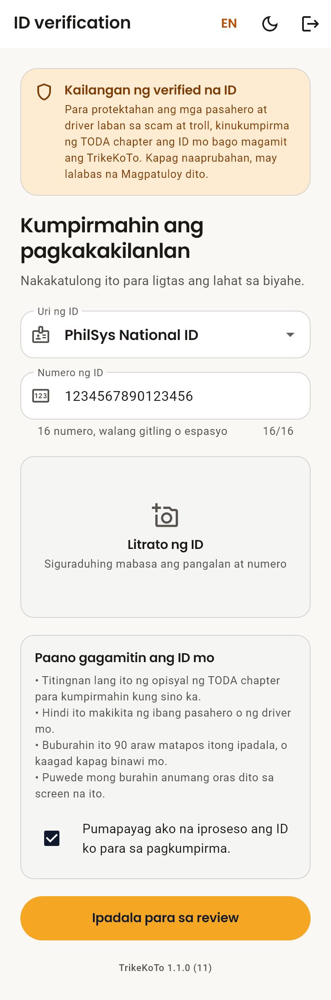

*Figure 1. The ID verification screen*

1. Choose your ID from **Uri ng ID** (ID type).
2. Type the number printed on the card in **Numero ng ID** (ID number), without dashes or spaces. The box accepts only as many characters as that ID uses, and says how many below it (see the table).
3. Tap the photo area and choose **Kunan ng litrato ang ID** (Photograph the ID) or **Pumili sa gallery** (Choose from gallery). Make sure the name and number can be read.
4. Read **Paano gagamitin ang ID mo** (How your ID is used), then tick **Pumapayag ako na iproseso ang ID ko para sa pagkumpirma** (I agree to my ID being processed for verification).
5. Tap **Ipadala para sa review** (Send for review).

The screen changes to **Hinihintay ang review** (Waiting for review). You do not need to keep it open.

| ID | ID number |
|---|---|
| PhilSys National ID | Exactly 16 digits |
| Driver’s License (LTO) | Exactly 11 letters or digits (a letter and 10 digits) |
| UMID, PhilHealth ID | Exactly 12 digits |
| Passport | Exactly 9 letters or digits |
| Postal ID | 8 to 20 letters or digits |
| Voter’s ID | 8 to 30 letters or digits |
| Senior Citizen, Student and Barangay ID | 4 to 20 letters or digits |

### 3.3 After review

| You see | What it means | What to do |
|---|---|---|
| **Beripikado na** (Verified) | The chapter approved your ID. | Tap **Magpatuloy** (Continue) to start using the app. |
| **Hindi tinanggap** (Not accepted) | The chapter could not accept it. The reason is shown below the title. | Tap **Bawiin at burahin ang ID** (Withdraw and delete the ID), then send a clearer photo or a different ID. |
| **Hinihintay ang review** (Waiting for review) | An officer has not looked at it yet. | Wait. Approval is done by a person, so it may take some time. |

> **Note:** Only one ID is ever needed per account. Once approved, the app shows **Beripikado ang ID** (ID verified) and will not ask again, even after the photo is deleted.

## 4. Commuter Guide

### 4.1 Creating your account

1. Open the app and tap **Mag-book ng ride** (Book a ride).
2. Under **Ano ang number mo?** (What is your number?), type your mobile number (09XX XXX XXXX) and tap **Ipadala ang code** (Send code).
3. Type the six-digit code from the SMS and tap **Kumpirmahin** (Confirm). To use a different number, tap **Ibang number** (Use a different number).
4. On **Konti na lang** (Almost done), add a photo if you like (you can skip it) and type the name the driver should call you.
5. Tap **Simulan** (Start).
6. Submit your ID and wait for approval (Section 3).

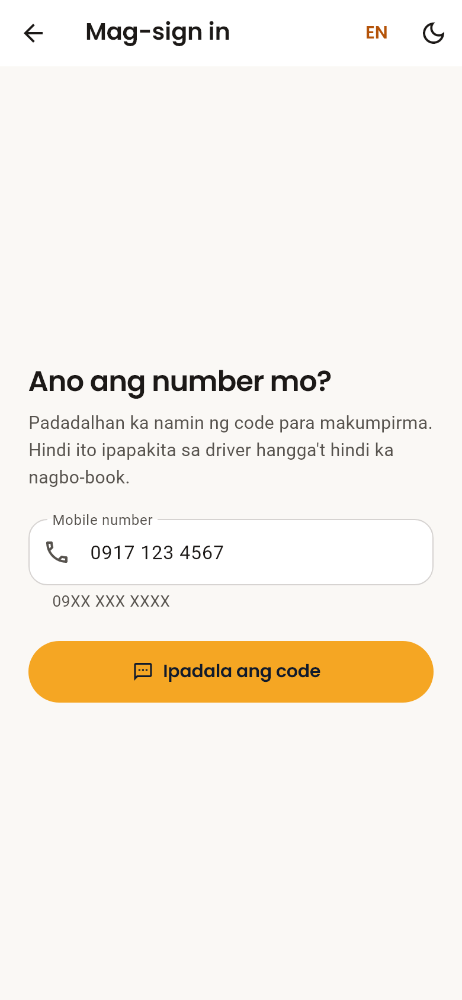

*Figure 2. Signing in with a mobile number*

> **Note:** Your number is not shown to any driver until you book a ride.

### 4.2 Booking a ride

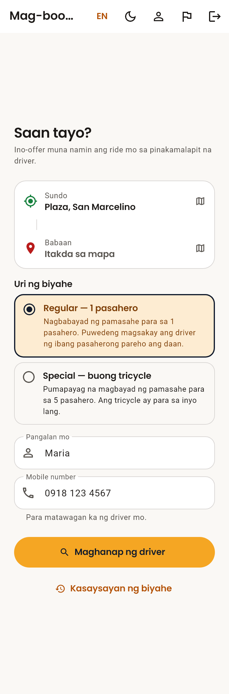

*Figure 3. The booking screen*

1. On **Saan tayo?** (Where to?), check **Sundo** (Pickup). The app fills it in with your current location. To change it, tap it and set it on the map (Section 4.3).
2. Tap **Babaan** (Drop-off) and set where you are going.
3. Check the trip line, which shows the distance and about how many minutes the trip takes.
4. Under **Uri ng biyahe** (Type of trip), choose **Regular — 1 pasahero** (Regular — 1 passenger) or **Special — buong tricycle** (Special — whole tricycle) (see the table below). Regular is chosen unless you change it.
5. Check your name and mobile number, so the driver can find and call you.
6. Tap **Maghanap ng driver** (Find a driver).

| Type of trip | What it means |
|---|---|
| **Regular — 1 pasahero** (Regular — 1 passenger) | You pay the fare for one passenger. The driver may take other passengers going the same way. |
| **Special — buong tricycle** (Special — whole tricycle) | You agree to pay the fare for five passengers, and the tricycle is yours alone. The driver sees this before accepting. |

> **Note:** The app does not show or charge a fare. Pay the posted TODA fare to the driver in cash.

#### If a place is outside the chapter’s area

Your TODA may set the area it normally serves. If your pickup or drop-off falls outside it, a notice appears above **Maghanap ng driver** (Find a driver) naming which one.

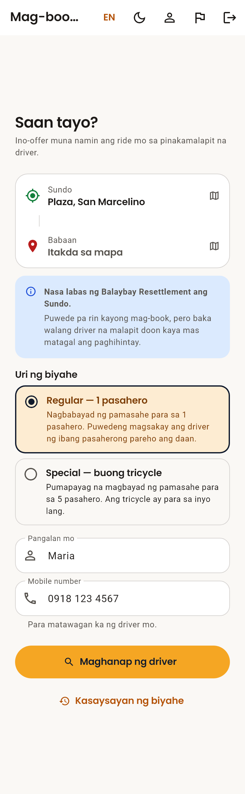

*Figure 4. A trip that leaves the chapter’s area*

**You can still book.** It is a warning, not a barrier — tricycles do leave the area, for the highway or the hospital. It tells you the one thing you could not otherwise know: there may be no driver near that end of the trip, so the wait may be longer.

### 4.3 Setting a place on the map

There are three ways to place the pin:

- Type a place in **Maghanap ng lugar** (Search a place) and tap **Hanapin** (Search).
- Drag the map, or tap a spot on it, to move the pin.
- Tap **Nasa akin ngayon** (Where I am now) to use your current location.

Then type a name for the place in **Pangalanan ang lugar** (Name this place) — for example Plaza, Palengke or Barangay Hall — and tap **Kumpirmahin ang location** (Confirm location). The driver sees this name.

### 4.4 Waiting for a driver

The screen shows **Naghahanap ng driver…** (Looking for a driver…). The system offers your ride to the nearest available driver first. If that driver does not answer within 15 seconds, it asks the next nearest, and so on. The line **Natanong na ang 3 sa 10 malapit na driver** (Asked 3 of 10 nearby drivers) shows how many have been asked.

- The search continues even if you close the app.
- After **3 minutes** with no driver, the app says so: **Wala pang tumatanggap** (No driver has accepted yet). Tap **Maghintay pa** (Keep waiting) to let the search go on, or **Kanselahin ang ride** (Cancel ride) to look for another ride. If the app is closed, a notification says the same thing. You are told only once per booking.
- If no driver accepts after 10 drivers or about 5 minutes, the search stops, the app shows **Walang nakitang driver. Subukan ulit mamaya.** (No driver found. Try again in a few minutes.), and the booking screen appears again.

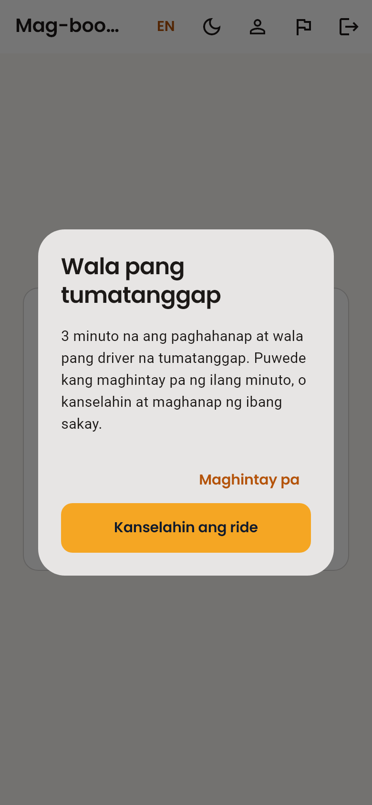

*Figure 5. After three minutes with no driver*

### 4.5 When a driver accepts

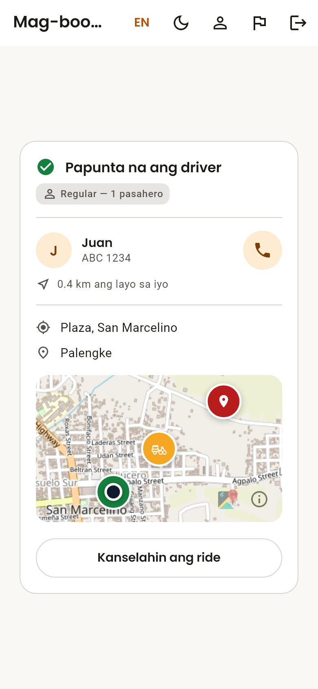

*Figure 6. Tracking an accepted ride*

The screen changes to **Papunta na ang driver** (Driver is on the way) and shows the driver’s name and tricycle plate number. Below the name is how far away the driver is, and it updates as the tricycle moves:

- **0.4 km ang layo sa iyo** (0.4 km from you) — measured to where your phone is, when the app is allowed to use your location. If you walk away from the pin, this still measures to you.
- **0.4 km ang layo sa sundo** (0.4 km from the pickup) — measured to the pickup pin, when the app cannot use your location.

The map shows where the driver is, the pickup and drop-off pins, and a dot where you are. Tap the map to open it full screen. The distance is a straight line, so the road trip may be a little longer.

- To call the driver, tap the phone button, **Tawagan si …** (Call …).
- When the trip starts, the screen changes to **Papunta na sa babaan mo** (On the way to your drop-off).

#### Sharing a regular trip

On a **Regular — 1 pasahero** (Regular — 1 passenger) trip the driver may pick up another passenger going the same way, as tricycles do at a terminal. When that happens:

- **Your fare does not change.** You pay for one passenger either way.
- The trip may include a short stop to collect or drop the other passenger. The app only lets the driver be offered rides that stay close to your route.
- If you would rather travel alone, choose **Special — buong tricycle** (Special — whole tricycle) when booking. A special trip is never shared.

### 4.6 Cancelling a ride

Tap **Kanselahin ang ride** (Cancel ride). You can cancel while searching and after a driver accepts, but **not after the trip has started**.

### 4.7 Rating your driver

After you are dropped off, the app asks **Kumusta ang biyahe mo?** (How was your ride?). Tap 1 to 5 stars. Each ride can be rated **once**, and the rating cannot be changed.

### 4.8 Your profile

Tap your photo at the top of the booking screen (a person icon if you have not added one) to open **Profile**.

- **Photo** — tap it to take a new one, choose from the gallery, or **Alisin ang litrato** (Remove photo). Tap **I-save** (Save) to keep the change.
- **Name** — edit it and tap **I-save** (Save).
- **Mobile number** — shown as confirmed. It cannot be edited. Signing in with a different number creates a separate account, which needs its own ID verification.
- **ID** — shows **Beripikado ang ID** (ID verified) once approved. Tap it to see your ID or delete the photo.

#### Deleting your account

1. At the bottom of Profile, tap **Burahin ang account** (Delete account).
2. Read what will be deleted and what will be kept, then confirm.

Your name, photo, ID and account are deleted permanently. Past rides stay as a TODA record, but your name and number are removed from them. If the app asks you to sign in again first, do so — this is a security check.

### 4.9 Reporting a problem

1. Tap the flag icon at the top of the screen.
2. Choose **Problema** (Problem), **Mungkahi** (Suggestion), **Tanong** (Question) or **Iba pa** (Other).
3. Describe what happened in **Ano ang nangyari?** (What happened?).
4. Add a contact in **Contact (opsyonal)** (Contact (optional)) only if you want a reply.
5. Tap **Ipadala ang report** (Send report).

### 4.10 Your ride history

Tap **Kasaysayan ng biyahe** (Ride history) below the **Maghanap ng driver** (Find a driver) button. Your rides are listed newest first, 30 at a time; tap **Ipakita pa** (Show more) for older ones.

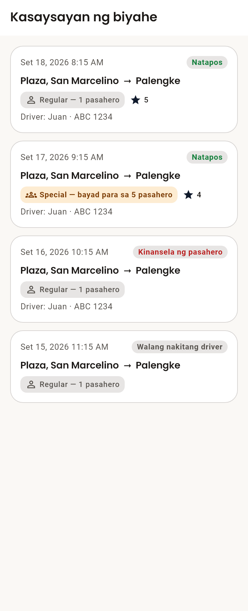

*Figure 7. Ride history*

Each ride shows the date, the route, how it ended — **Natapos** (Completed), **Kinansela ng pasahero** (Cancelled by commuter), **Kinansela ng driver** (Cancelled by driver) or **Walang nakitang driver** (No driver found) — whether it was Regular or Special, the driver’s name and plate, and the stars you gave.

## 5. Driver Guide

### 5.1 Registering

1. Open the app and tap **Mag-sign in bilang driver o admin** (Driver / Admin sign in).
2. Tap **Magparehistro bilang TODA driver** (Register as a TODA driver).
3. Fill in the form (see the table below).
4. Tap **Gumawa ng account** (Create account).
5. Submit your ID (Section 3).

| Field | What to enter |
|---|---|
| **Pangalan** (First name) / **Apelyido** (Last name) | Your name, as printed on your license. |
| **Mobile number** | The number commuters will call when you accept their ride. |
| **Body number** | The number on your tricycle. Commuters use it to find you. |
| **TODA chapter** | The chapter you belong to. |
| **Email** and **Password** | What you will use to sign in. The password needs at least 6 characters. |

### 5.2 Waiting for approval

Two approvals are needed before you can take rides: your **ID** (Section 3) and your **driver registration**. The banner at the top of the driver screen shows your registration status and updates on its own.

When your registration is approved, a notice appears in **Mga abiso** (Notifications) — **Aprubado na ang account mo** (Account approved) — and the bell shows a number. If notifications are allowed on your phone, it may also appear as a phone notification. You do not need to wait on the screen: approval can take hours, and the notice stays until you open it (Section 5.8).

| Banner | Meaning |
|---|---|
| **Hinihintay ang verification** (Pending verification) | An administrator has not approved you yet. Tell your TODA officer you have registered. |
| **Verified TODA driver** | You are approved and can go online. |
| **Naka-suspend ang account mo** (Your account is suspended) | You cannot accept rides. Talk to your TODA officer. |
| **Hindi natanggap ang registration mo** (Your registration was rejected) | Talk to your TODA officer. |

### 5.3 Going online

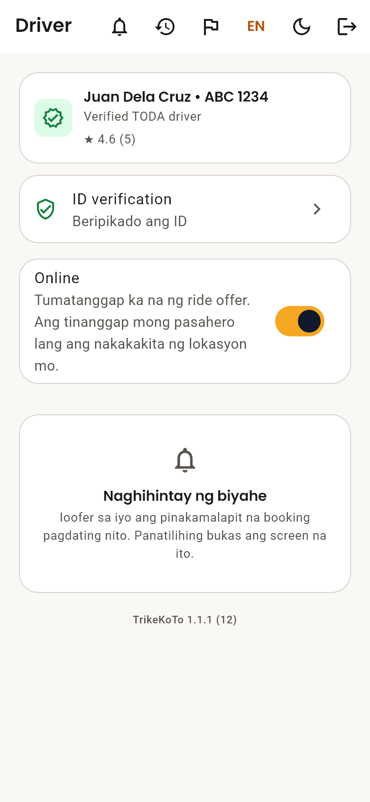

*Figure 8. The driver screen with the Online switch*

1. Turn on **Location** on your phone.
2. Slide the **Offline** switch to **Online**.
3. If asked, allow location access **while using the app**, and allow notifications.
4. Wait while the switch shows **Kumokonekta…** (Connecting…). Do not tap it again.

When the switch shows **Online**, the system can offer you rides booked nearby, and the screen says **Naghihintay ng biyahe** (Waiting for a ride).

> **Note:** Commuters do not see online drivers on a map. Only the passenger whose ride you accept sees where you are, and only until that trip ends — which is what the line under the switch now says.

Keep TrikeKoTo open while you are online — you can lock the screen. The app checks in every two minutes, even when you are standing still, so the system knows you are still there.

A weak signal no longer costs you rides outright. If your check-ins stop arriving, you are offered rides **after** the drivers whose check-ins are arriving — so you still get one when nobody else is free, which at a terminal with a bad signal is often. Only after about **30 minutes** of silence does the system treat your phone as switched off and stop offering at all. Open the app to come back.

If going online fails, a red message explains why (see Section 8). If a line starting with **Detalye para sa suporta** (Details for support) appears under the switch, take a screenshot and send it to your TODA officer.

### 5.4 Accepting a ride

When a commuter nearby books, the offer comes to you at once: your phone shows a notification and the screen shows **Bagong ride offer** (New ride offer) with the trip type, the pickup and drop-off, the passenger’s name, and how far the pickup is from you — for example **Sundo: 0.4 km ang layo** (Pickup: 0.4 km away).

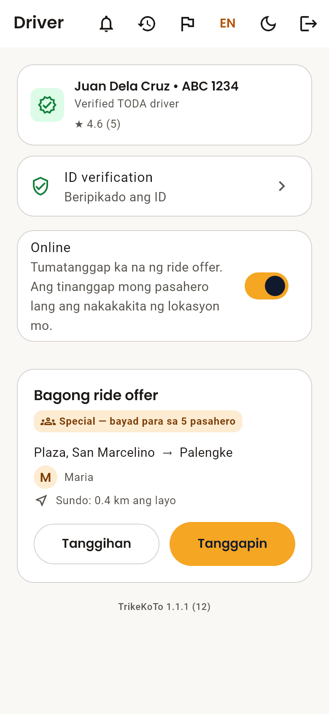

*Figure 9. A ride offer*

- **Tanggapin** (Accept) — the ride is yours.
- **Tanggihan** (Decline) — the ride goes to the next nearest driver.

Each offer is labelled **Regular — 1 pasahero** (Regular — 1 passenger) or **Special — bayad para sa 5 pasahero** (Special trip — fare for 5 passengers). On a special trip the commuter pays the fare for five passengers and has the tricycle alone, so do not take other passengers.

Each offer lasts about 15 seconds. If you do not answer in time, the ride goes to another driver. If two drivers accept at the same moment, only one gets the ride, and the app tells the other.

You are never offered a new ride while you are carrying a passenger, or while another offer is waiting for your answer. The pickup distance is a straight line from where your phone last reported being.

### 5.5 Carrying more than one passenger

On a regular trip you may be offered another passenger while you already have one. The offer says **Kasabay na pasahero** (Another passenger, same way) and only arrives when the new trip stays close to the route you are already on.

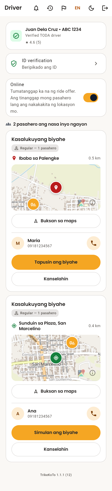

*Figure 10. Two passengers at once*

- **Each ride is its own card**, with its own map and its own buttons. Start and finish each one as that passenger gets on and off.
- A line above the cards says how many passengers are with you: **2 pasahero ang nasa inyo ngayon** (2 passengers with you now).
- Each passenger pays their own fare, as on any regular trip.
- A **Special — buong tricycle** (Special — whole tricycle) trip is never shared, in either direction: you are not offered one while carrying somebody, and a special passenger is never joined by another.
- You decide. If the road, the load or the passenger makes it a bad idea, tap **Tanggihan** and the ride goes to another driver.

Your TODA sets how many passengers at once (three by default) and how far out of your way the next one may take you (1.5 km by default). See Section 6.6.

### 5.6 During the ride

The **Kasalukuyang biyahe** (Current ride) card shows a map to **Sunduin sa …** (Pick up at …) and then **Ibaba sa …** (Drop off at …).

- **Buksan sa maps** (Open in maps) opens directions in your maps app.
- The phone button calls the commuter if you cannot find them.

1. When the passenger is on board, tap **Simulan ang biyahe** (Start trip).
2. When they have been dropped off, tap **Tapusin ang biyahe** (Complete ride).
3. Collect the posted TODA fare in cash.

To call off a ride, tap **Kanselahin** (Cancel).

### 5.7 Going offline

Slide the switch back to **Offline**. You stop receiving offers and the app stops using your location. Go offline when you finish your shift — staying online uses battery and data.

### 5.8 Your ride history

Tap the clock icon at the top of the driver screen to open **Kasaysayan ng biyahe** (Ride history). It lists your completed and cancelled rides, newest first, with the route, the trip type, the passenger’s name and their rating. Passengers’ phone numbers are not shown once a ride is over.

### 5.9 Notifications

Tap the bell at the top of the driver screen to open **Mga abiso** (Notifications). Messages from the system about your account are kept here — today, the notice that the TODA has approved your registration.

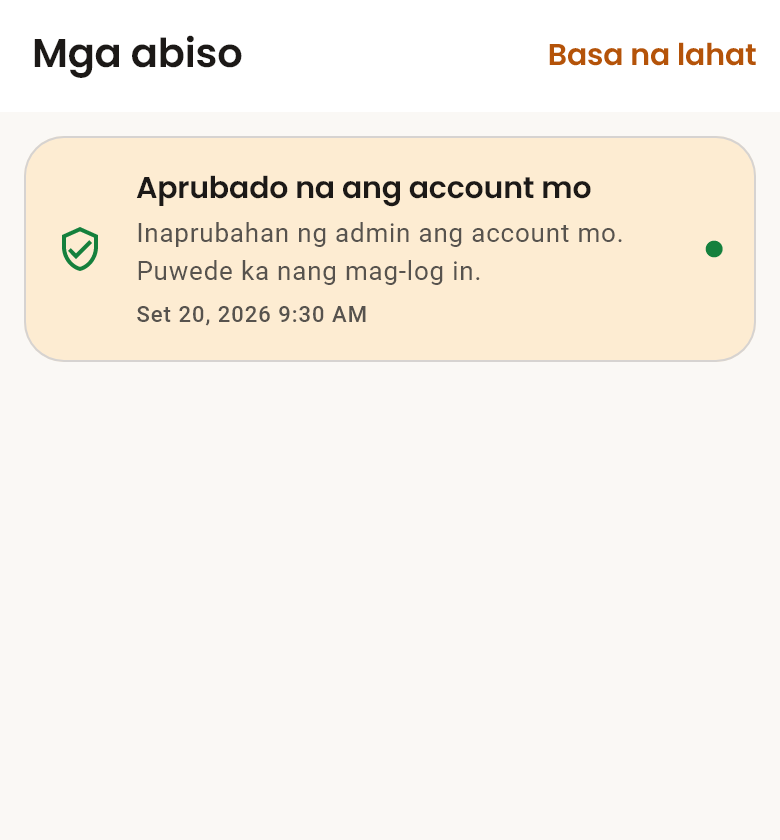

*Figure 11. The notification area*

- A notice you have not read has a coloured background and a dot, and is counted on the bell.
- Tap a notice to mark it read. It stays in the list afterwards.
- **Basa na lahat** (Mark all read) marks every notice read at once.
- If there are none, the screen says **Wala pang abiso** (No notifications yet).

## 6. Administrator Guide

### 6.1 Getting access

Administrator accounts cannot be created from inside the app. The project team adds your email address to the list of administrators. You then:

1. Open the app and tap **Mag-sign in bilang driver o admin** (Driver / Admin sign in), then sign in with your email and password.
2. If you see **Kumpirmahin ang email mo** (Confirm your email), tap **Ipadala ang verification email** (Send verification email), open the link in your email (check spam), come back and tap **Nakumpirma ko na** (I have confirmed it).

You only confirm your email once. If you are taken to the driver screen instead, your administrator entry does not match your email address; contact the project team.

### 6.2 The dashboard

The administrator dashboard has shortcuts to **Feedback**, **Dispatch**, **ID review** and **Kasaysayan ng biyahe** (Ride history), a ride summary, and the list of drivers.

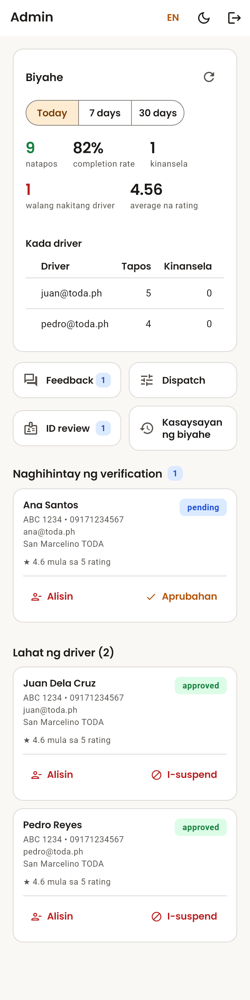

*Figure 12. The administrator dashboard*

#### Ride summary

Choose **Today**, **7 days** or **30 days**, then tap **I-refresh** (Refresh). The summary does not update live while you watch it; tap it again to load the latest rides.

| Figure | Meaning |
|---|---|
| **natapos** (completed) | Rides that finished. |
| **completion rate** | Completed rides out of all rides that ended. Rides still in progress are not counted. |
| **kinansela** (cancelled) | Rides called off by the commuter or the driver. |
| **walang nakitang driver** (no driver found) | Rides no driver accepted. A high number means too few drivers online or a search radius that is too small. |
| **average na rating** (avg rating) | The average star rating of rated rides. |

Below the figures are a daily chart and a **Kada driver** (By driver) table.

### 6.3 Approving drivers

New registrations appear under **Naghihintay ng verification** (Pending verification) with their name, plate, mobile number, email and TODA chapter.

1. Check the details against your chapter records. The app only records what the driver typed.
2. Tap **Aprubahan** (Approve). The driver’s app updates within seconds.

The driver receives a notice that their account is approved (Section 5.8). You do not need to message them.

To stop a driver from accepting rides, tap **I-suspend** (Suspend) on their entry in **Lahat ng driver** (All drivers). To reinstate them, tap **Aprubahan** (Approve). Suspending can be undone; use it for everyday problems.

#### Removing a driver

Remove a driver only for a registration that should never have been made — a duplicate, a test account, someone who is not a chapter member — or for a member who has left for good. **It cannot be undone.**

1. Find the driver in **Naghihintay ng verification** (Pending verification) or **Lahat ng driver** (All drivers).
2. Tap **Alisin** (Remove).
3. Read the message, then tap **Alisin** (Remove) again to confirm, or **Huwag** (Keep) to cancel.

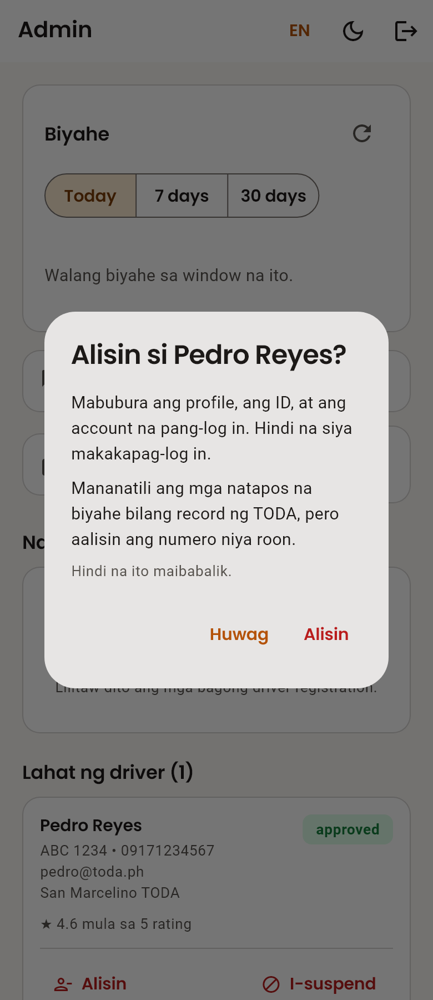

*Figure 13. Confirming that a driver should be removed*

Removing deletes the driver’s profile, their ID and its photo, the record that their ID was checked, their notices, and their sign-in account, so they can no longer log in. Their **finished rides are kept** as the chapter’s record — who drove, which tricycle, when, and the rating — with the driver’s phone number removed.

A driver who is carrying or collecting a passenger cannot be removed: the card shows **May biyahe pa — suspindihin muna** (On a ride — suspend instead). Suspend them, wait for the trip to end, then remove them.

### 6.4 Reviewing IDs

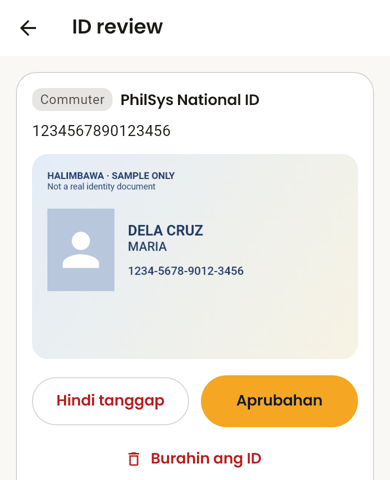

*Figure 14. Reviewing a submitted ID*

1. Open **ID review** (ID review). Each card shows whether the person is a driver or commuter, the ID type and number.
2. Tap **Tingnan ang ID** (View the ID) and check the photo.
3. If the ID is valid and matches, tap **Aprubahan** (Approve).
4. If not, tap **Hindi tanggap** (Not accepted), type the reason (for example, a blurry photo), and tap **Ipadala** (Send). The person sees your reason.

> **Note:** **Aprubahan** (Approve) stays disabled until you have opened the photo — an ID has to be seen before it can be approved. ID photos are never saved on your phone. **Review IDs in the Android app.** Opening an ID in the web version creates a link to the photo that anyone who has it could open.

#### Deleting an ID

After you approve one, the app asks whether to delete the photo now. **Alisin** (Delete the ID) removes the photo and the ID details; the verification stays, so that person never has to send an ID again. **Huwag muna** (Keep for now) leaves it, and retention deletes it 90 days after it was sent.

You can also delete a submission without deciding on it — **Burahin ang ID** (Delete the ID) at the bottom of the card — for the ones that turn out to be a receipt or a second copy of a card you have already approved.

> **Note:** Deleting the photo as soon as you have finished looking is the safer habit: an ID is sensitive personal information, and the only reason to hold it was to check it once.

### 6.5 Handling feedback

Reports from drivers and commuters are listed under **Kailangan ng atensyon** (Needs attention). After acting on one, tap **Markahang naresolba** (Mark resolved). If the problem returns, tap **Buksan ulit** (Reopen) under **Naresolba** (Resolved).

### 6.6 Dispatch settings

Changes here reach every phone within seconds, without an app update.

| Setting | Default | Allowed | What it does |
|---|---|---|---|
| **Search radius (km)** | 5 | 0.5–50 | Drivers farther than this are never offered the ride. |
| **Offer timeout (seconds)** | 15 | 5–120 | How long one driver has to answer before the next is asked. |
| **Bilang ng driver na susubukan** (Drivers to try) | 10 | 1–10 | How many drivers are asked before the search stops. |

Tap **I-save ang settings** (Save settings) after editing.

#### Shared rides

On a regular trip a driver may be offered a second passenger going the same way; on a special trip never.

| Setting | Default | What it does |
|---|---|---|
| **Puwede ang kasabay** (Allow sharing) | On | Off means one passenger per trip, for the whole chapter. |
| **Pinakamaraming pasahero** (Most passengers at once) | 3 | Counting the first. A tricycle seats more, but a driver juggling four drop-offs from a phone is how somebody gets taken past their street. |
| **Dagdag na layo (km)** (Extra distance (km)) | 1.5 | How far the trike may go out of its way for the next passenger. Checked against **every** passenger already aboard, not the average. |

#### Service area

Set the centre by tapping **Itakda ang gitna sa mapa** (Set the centre on the map), give the area a name and a radius. A commuter whose pickup or drop-off falls outside it is told so — and can still book (Section 4.2).

> **Note:** Leave the radius at 0 until you have set the centre. 0 means no warning at all, which is better than a warning that fires on every legitimate booking.

#### Stopping bookings

To halt the service, turn off **Tumatanggap ng booking** (Accepting bookings) and confirm with **Ihinto ang booking** (Stop bookings). Commuters cannot book until you turn it back on. **Rides already in progress finish normally.**

### 6.7 Ride history

Open **Kasaysayan ng biyahe** (Ride history) from the dashboard. Every ride in the chapter is listed, newest first, with the commuter’s name and number, the driver, the trip type, the outcome and the rating. Use **Lahat** (All), **Natapos** (Completed), **Kinansela** (Cancelled) or **Walang nakitang driver** (No driver found) to show one outcome only.

#### Removing a commuter

Use this for an account that is abusing the service — repeated bookings nobody turns up for, or a passenger harassing drivers. There is no list of commuters in the app, on purpose: a ride is the only place you can find one.

1. In the ride history, find a ride the person booked.
2. Tap **Alisin ang pasahero** (Remove commuter) under their name.
3. Read the message, then tap **Alisin** (Remove) to confirm.

Their profile, ID, the record that their ID was checked, and their sign-in account are deleted, and any booking they are still waiting on is cancelled. Their rides stay, but the name becomes **Deleted account** and the number is removed. **It cannot be undone.**

## 7. Your Data and Privacy

### 7.1 Your government ID

- Only TODA chapter officers can see your ID, to confirm who you are. Other passengers and drivers cannot.
- The ID photo and details are deleted automatically **90 days** after you submit them, or immediately when you withdraw them.
- You can delete your ID at any time from the ID verification screen with **Bawiin at burahin ang ID** (Withdraw and delete the ID).

### 7.2 Verification stays with your account

Deleting the ID photo does not undo your verification. Only the fact that you were verified is kept, with no ID details. It is removed when you delete your account.

### 7.3 What others see

| Who | Sees |
|---|---|
| A driver offered or assigned your ride | Your name, photo (if you added one), mobile number, pickup and drop-off. |
| A commuter on your ride | The driver’s first name, plate number and live location. |
| TODA administrators | Driver details, ride records, feedback, and submitted IDs for review. |

### 7.4 When an account is removed

|  | Deleted | Kept |
|---|---|---|
| A commuter deletes their account, or an administrator removes it | Profile, photo, ID and its photo, the record that the ID was checked, and the sign-in account. A booking still waiting is cancelled. | Past rides, with the name shown as **Deleted account** and the number removed. |
| An administrator removes a driver | Profile, ID and its photo, the record that the ID was checked, notices, and the sign-in account. A ride in progress is cancelled. | Finished rides, with the driver’s name and plate but not their phone number. |

## 8. Troubleshooting

Messages are listed in Filipino, with the English wording in brackets.

### 8.1 Signing in

| Message | What to do |
|---|---|
| **Mali ang code. Tingnan ulit ang message.** (Wrong code. Check the message again.) | Type the six digits from the latest SMS. |
| **Nag-expire na ang code. Humingi ng bago.** (That code expired. Ask for a new one.) | Go back and tap **Ipadala ang code** (Send code) again. |
| **Masyadong maraming subok…** (Too many tries…) | Wait a few minutes before trying again. |
| **Walang connection. Tingnan ang signal mo.** (No connection. Check your signal.) | Move to a place with signal, or switch between mobile data and Wi-Fi. |
| **Mukhang hindi ito mobile number.** (That does not look like a mobile number.) | Enter an 11-digit number starting with 09. |

### 8.2 ID verification

| Message | What to do |
|---|---|
| **Kailangan ng litrato ng ID.** (A photo of the ID is required.) | Add a photo of the card before sending. |
| **Kailangan mong pumayag muna.** (You need to agree first.) | Tick the agreement box. |
| **Kailangan ng 16 numero** (Must be exactly 16 digits) (or another count) | The number is too short or too long for the ID type chosen. Check the ID type, then type every digit on the card, without dashes. |
| **Hindi tinanggap ng server ang litrato…** (The server refused the photo…) | Your ID may already be approved. Go back; if the app still asks for an ID, contact your TODA officer. |

### 8.3 Booking

| Problem or message | What to do |
|---|---|
| **Wala pang tumatanggap** (No driver has accepted yet) | The search has run for 3 minutes. Tap **Maghintay pa** (Keep waiting) to keep searching, or cancel. |
| **Walang nakitang driver. Subukan ulit mamaya.** (No driver found. Try again in a few minutes.) | No driver was available nearby. Try again in a few minutes. |
| **Nasa labas ng … ang Sundo** (The pickup is outside …) | The place is outside the area your TODA normally serves. You can still book; the wait may be longer. |
| **Walang nakitang … malapit dito** (Nothing called … found near here) | Drag the map to the area first, or place the pin by hand. |
| **Tinatantiya — hindi maabot ang route service** (Approximate — could not reach the route service) | The distance is an estimate. You can still book. |
| **Hindi mabuksan ang dialler…** (Could not open the dialler…) | Dial the number shown in the message by hand. |

### 8.4 Going online (drivers)

| Message | What to do |
|---|---|
| **Naka-off ang location ng phone…** (Your phone’s location is off…) | Turn on Location in the phone’s quick settings. |
| **Kailangan ng location permission para mag-online.** (Location permission is needed to go online.) | Try again and allow location access. |
| **Naka-block ang location permission…** (Location permission is blocked…) | Open the phone’s Settings > Apps > TrikeKoTo > Permissions > Location, and allow it. |
| **Hindi makakuha ng location…** (Cannot get a location fix…) | Move outdoors or near a window, then try again. |
| **Hindi pinayagan ng server na mag-online…** (The server refused to put you online…) | Check that your ID and registration are approved. If they are, send a screenshot to your TODA officer. |
| **Hindi naisave sa server ang location mo…** (Your location could not be saved…) | Check your internet connection, then try again. |
| No offers arrive while Online | Open TrikeKoTo: if it was closed or out of signal for about five minutes, it has to check in again before offers resume. Check that notifications are allowed for TrikeKoTo, and that a commuter is within the search radius. |
| The bell shows a number | You have an unread notice. Tap the bell to read it (Section 5.9). |
| An offer arrived while you already had a passenger | That is a shared ride: the new trip is on your current route (Section 5.5). Accept it or decline it — declining costs you nothing. |

### 8.5 Administrators

| Message | What to do |
|---|---|
| **May biyahe pa — suspindihin muna** (On a ride — suspend instead) | The driver is carrying or collecting a passenger. Suspend them, wait for the trip to end, then remove them. |
| **Para sa seguridad, mag-sign in muli bago burahin ang account.** (For security, sign in again before deleting the account.) | Shown to a commuter deleting their own account. They sign out and in again first — or you remove the account from the ride history (Section 6.7). |

### 8.6 Getting help

Use the flag icon (Section 4.9) to send a report to your TODA administrator. Include what you were doing, and the message on screen if there was one. If the app closes unexpectedly, the error is recorded automatically for the project team.

